# 前端界面优化：前后对比

所有截图均在 1600×960 视口下、使用同一段参考视频（146 秒 AMV，基础分析，175 个镜头）拍摄。
`before/` 为优化前，`after/` 为优化后，文件名一一对应。

重新生成截图（需先启动 core 后端与 Vite 前端）：

```bash
node scripts/ui-screenshots.mjs docs/screenshots/after
```

## 0. 分析进行中

| 优化前 | 优化后 |
| --- | --- |
| 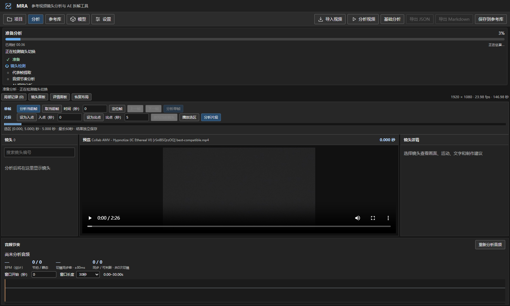 | 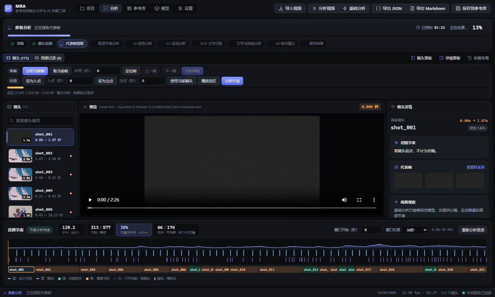 |

- 竖排阶段列表（占满整屏宽、只显示前几项）→ 横向阶段胶囊条，10 个阶段一行可见，当前阶段高亮
- 进度条加入流光动画，用时 / 预计剩余 / 百分比集中在右上角

## 1. 项目

| 优化前 | 优化后 |
| --- | --- |
| 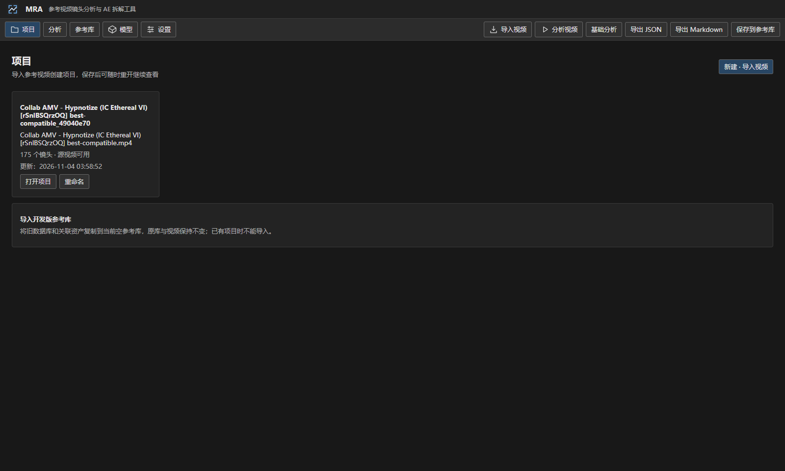 | 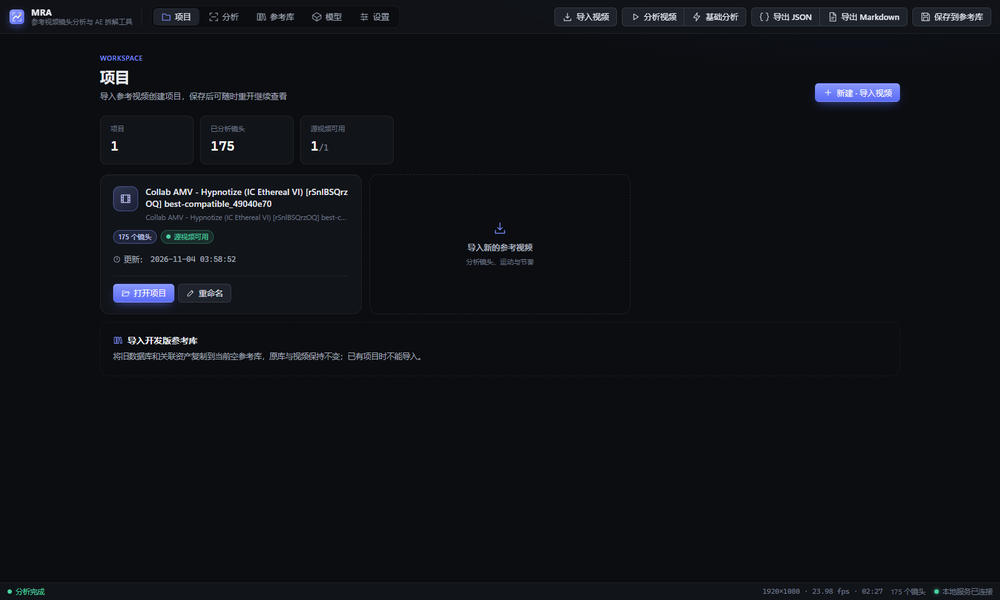 |

- 新增统计行（项目数 / 已分析镜头 / 源视频可用）
- 项目卡片：图标、长文件名截断、状态胶囊（源视频可用 / 缺失）、主次按钮
- 新增"导入新的参考视频"虚线卡片；无项目时显示三步引导

## 2. 分析工作台

| 优化前 | 优化后 |
| --- | --- |
| 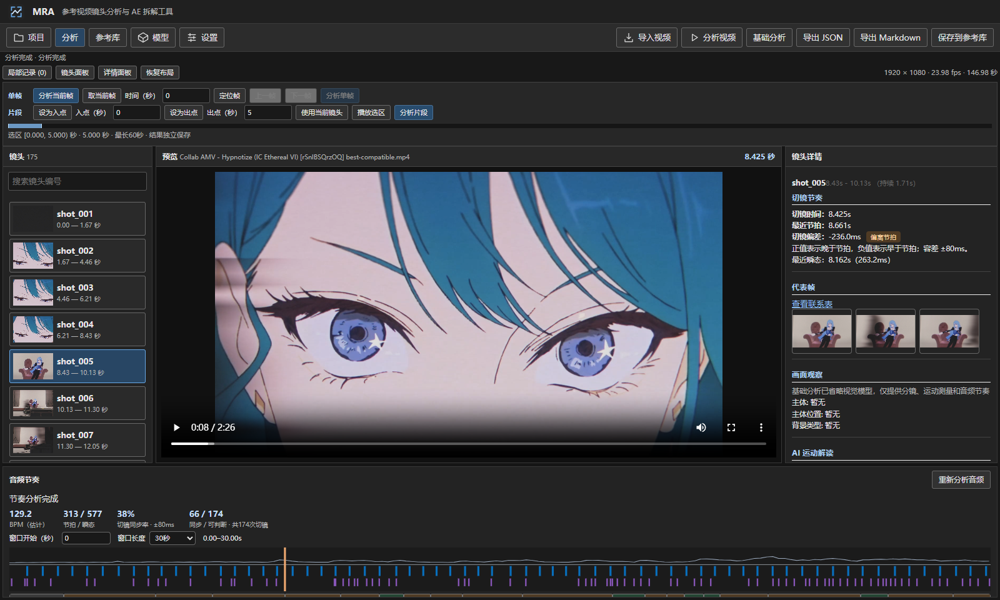 | 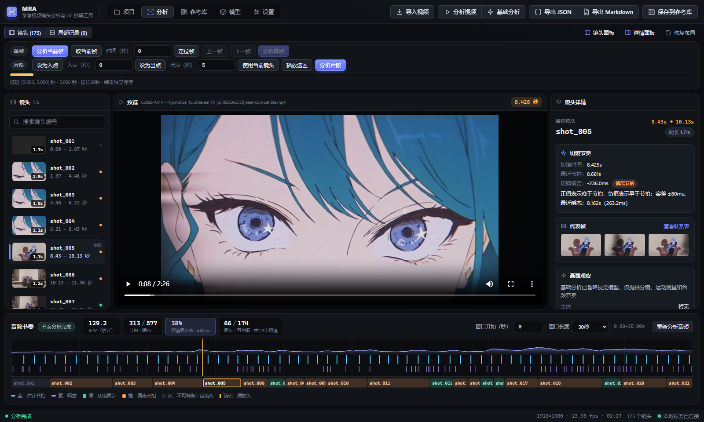 |

- 顶部两行（标题栏 + 工具栏）合并为一个 54px 应用栏：分段式导航、分组按钮（分析 / 导出），下一步操作自动高亮为主按钮
- 面板圆角卡片化；镜头列表加入时长角标、节拍同步指示点、选中强调条
- 镜头详情改为分区卡片 + 键值网格；运动测量改为数值卡片 + 进度条
- 时间码统一等宽字体 + 琥珀色，与时间轴播放头颜色一致
- **修复**：原时间轴底部的镜头切换条被裁切看不到，现在完整显示且高亮当前镜头
- 节拍 / 瞬态线条改为高对比色（原深蓝在深色背景上几乎不可见），波形加渐变填充，图例加色块
- 新增底部状态栏（分析状态、视频参数、镜头数、服务连接）

## 3. 参考库

| 优化前 | 优化后 |
| --- | --- |
| 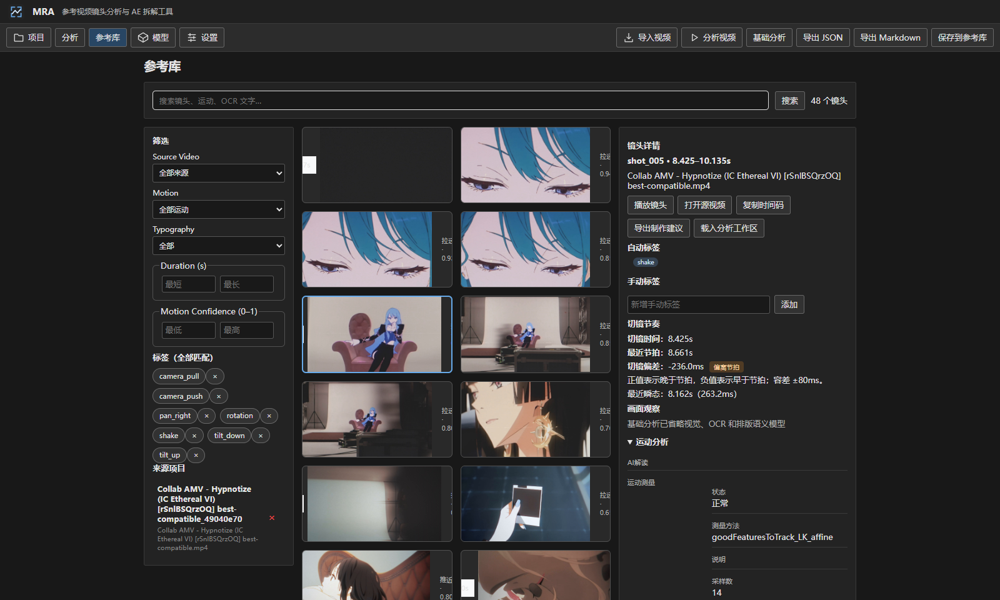 | 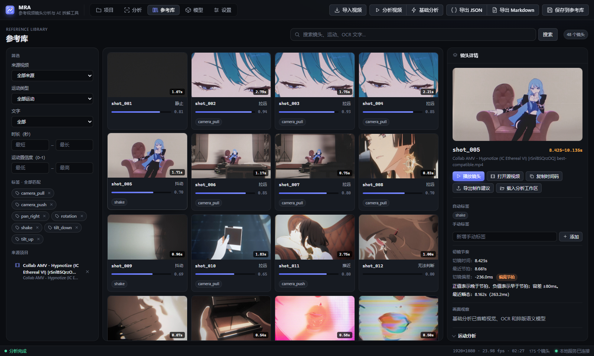 |

- **修复**：全局 `button{display:inline-flex}` 导致镜头卡片内容横向挤压，缩略图和运动类型被截断
- 三栏各自独立滚动，占满可用高度
- 镜头卡片：16:9 缩略图、时长 / 文字角标、置信度条、悬停上浮
- 筛选项中文化（Source Video → 来源视频 等），标签筛选改为可切换胶囊
- 详情栏：缩略图预览、带图标的操作按钮、可折叠分组

## 4. 模型

| 优化前 | 优化后 |
| --- | --- |
| 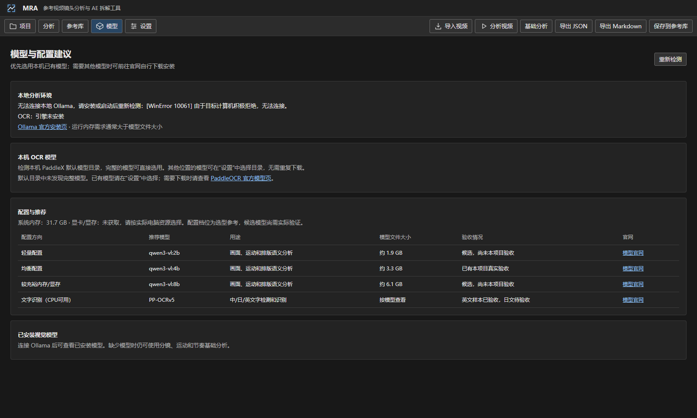 | 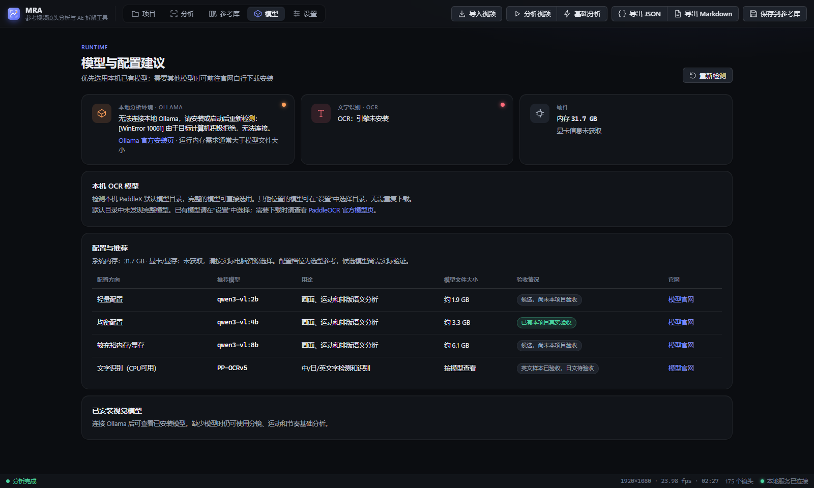 |

- Ollama / OCR / 硬件三张状态卡，带状态色指示点
- 推荐表格：模型名等宽字体、验收状态胶囊、行悬停

## 5. 设置

| 优化前 | 优化后 |
| --- | --- |
| 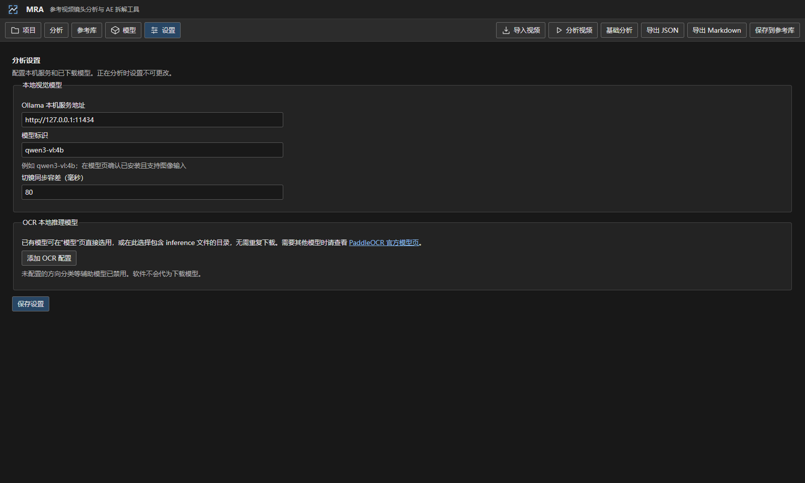 | 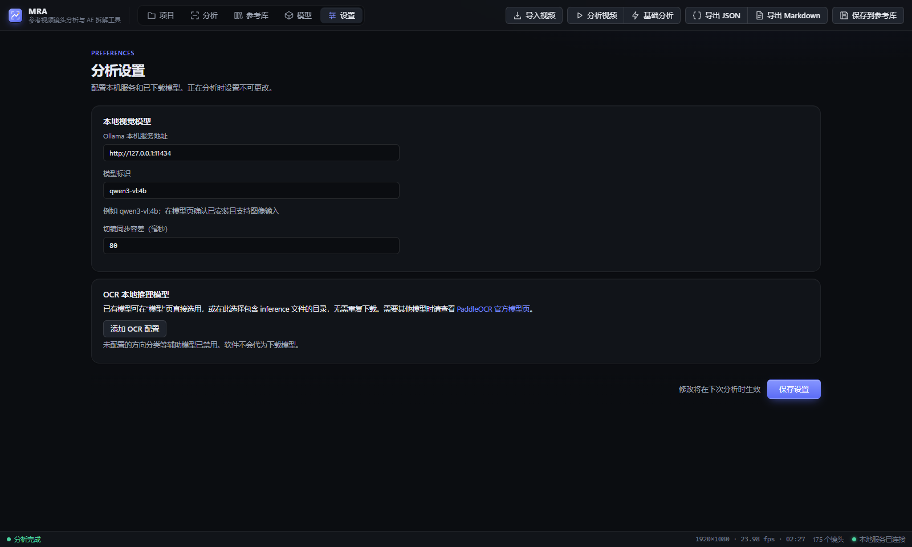 |

- 与其他页面统一的页头；分组卡片；底部保存栏

## 设计系统

`src/design/tokens.css` 定义了全部设计变量（5 级表面色、文字 3 级、主色 / 琥珀 / 语义色、圆角、阴影），
其余样式表只引用变量。原先 `App.css` 中的浅色主题残留规则与 `tokens.css` / `workbench.css` 中互相覆盖的深色规则已清理合并。
